# SentiMatrix: Parameter-Efficient LoRA Fine-Tuning for Multidimensional Sentiment Analysis

We replicated the main model of the SentiMatrix paper, **LoRA (Low-Rank Adaptation)** applied to encoder-based transformers, on four of its datasets: SST-2, CARER Emotion, Amazon E-Commerce (5-class) and SemEval-2014 ABSA. Each experiment was run with three random seeds on a Kaggle Tesla T4 GPU.

LoRA trains only about 0.2% to 1.2% of each model's parameters (299K to 1.2M). Our trainable-parameter counts match the paper exactly for all five model/dataset pairs, and accuracy and F1 land within about 1 to 2 points of the paper's published values. Only the LoRA model is reproduced. The paper's full fine-tuning and AdaLoRA comparisons are out of scope.

**SentiMatrix: Parameter-Efficient Fine-Tuning of Encoder-Based Transformers for Multidimensional Sentiment Analysis**
*Machine Learning (2026) 115:229 — Arafat, Akmal, Abosinnee, Orosz*
📄 [Paper Link](https://doi.org/10.1007/s10994-026-07161-4) | 💻 [Authors' Code](https://github.com/ELTE-DSED/senti-matrix)

---

## Repository Structure
```
SentiMatrix-LoRA-Sentiment-Analysis/
│
├── Code Files/
│   ├── nlp-replication-1.ipynb      (early SST-2 only version)
│   ├── nlp-replication-2.ipynb      (multi-dataset, single seed)
│   └── nlp-replication-3.ipynb      (final: all 4 datasets, 3 seeds)
│
├── Dataset/
│   └── Datasetlink.md
│
├── Documents/
│   ├── Research Paper.pdf
│   └── SentiMatrix LoRA Replication Project Report.docx
│
├── Results/
│   ├── Graphs/
│   │   ├── confusion_sst2.png, curves_sst2.png, ours_vs_paper_sst2.png
│   │   ├── confusion_emotion.png, curves_emotion.png, ours_vs_paper_emotion.png
│   │   ├── confusion_ecom5.png, curves_ecom5.png, ours_vs_paper_ecom5.png
│   │   └── confusion_absa.png, curves_absa.png, ours_vs_paper_absa.png
│   │
│   └── Tables/
│       ├── table_sst2_distilbert.png
│       ├── table_sst2_roberta.png
│       ├── table_emotion.png
│       ├── table_ecom5.png
│       └── table_absa.png
│
├── README.md
└── Requirement.txt
```

> `nlp-replication-3.ipynb` is the final notebook that produced every result in this README. Versions 1 and 2 are earlier iterations kept for reference.

---

## Problem Statement

Fine-tuning every parameter of a large transformer for sentiment analysis is expensive in memory, time and storage. This is a problem when a separate model is needed for every task (reviews, tweets, emotions, aspect-level opinions) or when the labelled data is small. Sentiment is also more than positive or negative. Real systems must handle fine-grained ratings, emotions and opinions about specific aspects, and they need predictions that are reliable, not just accurate.

The SentiMatrix paper addresses this with **LoRA**. The pretrained weights are frozen and only small low-rank adapter matrices plus the classifier head are trained. The paper reports up to 99.8% fewer trainable parameters while staying close to full fine-tuning in accuracy.

This project asks whether those claims can be reproduced independently. We implemented the paper's LoRA configuration for each dataset (its Table 3b), trained with three seeds, and compared accuracy, F1, calibration, parameter counts and cost against the published numbers.

---

## Datasets Used

| Dataset | Task | Classes | Rows used | Train / Val / Test | Model |
|---|---|---|---|---|---|
| SST-2 | Sentence sentiment | 2 | 9,613 | 7,690 / 961 / 962 | DistilBERT, RoBERTa-base |
| CARER Emotion | Emotion detection | 6 | 25,000 (subset) | 20,000 / 2,500 / 2,500 | DistilBERT |
| Amazon E-Commerce | Review rating | 5 | 22,641 | 18,112 / 2,264 / 2,265 | BERT-base-multilingual |
| SemEval-2014 ABSA (Laptop + Restaurant) | Aspect-based sentiment | 3 | 5,914 | 4,731 / 591 / 592 | DeBERTa-v3-base |

**Download Links** (all from the authors' repository, [ELTE-DSED/senti-matrix](https://github.com/ELTE-DSED/senti-matrix/tree/main/Dataset); also listed in [Dataset/Datasetlink.md](Dataset/Datasetlink.md)):
- SST-2: https://github.com/ELTE-DSED/senti-matrix/raw/main/Dataset/SST-2%20(2%20Classes).csv
- CARER Emotion: https://github.com/ELTE-DSED/senti-matrix/raw/main/Dataset/Emotion%20Dataset%20(Small).csv
- Amazon E-Commerce (5-class): https://github.com/ELTE-DSED/senti-matrix/raw/main/Dataset/E-Commerce%20Reviews%20(5%20Classes).csv
- SemEval-2014 ABSA: https://github.com/ELTE-DSED/senti-matrix/raw/main/Dataset/Laptop%20%2B%20Restaurant%20-%20ABSA.csv

> The Emotion file in the authors' repository is a 25,000-row subset, while the paper reports 75,000 rows.

---

## Methodology

### Stage 1 — Data Preparation

Each CSV is loaded and split into **80% train, 10% validation and 10% test**. The split is stratified with `random_state=42`, which gives exactly the same test set as the authors' code. Text is tokenised with the model's own tokenizer (maximum length 512, or 256 for E-Commerce) and padded dynamically per batch.

### Stage 2 — Model Selection

Each dataset uses the backbone the paper chose for it:

| Dataset | Backbone |
|---|---|
| SST-2 | `distilbert-base-uncased` and `roberta-base` |
| CARER Emotion | `distilbert-base-uncased` |
| Amazon E-Commerce | `bert-base-multilingual-uncased` |
| SemEval-2014 ABSA | `microsoft/deberta-v3-base` |

### Stage 3 — LoRA Configuration

LoRA adapters are injected into the attention projections with the `peft` library (`TaskType.SEQ_CLS`). The classification head is trained fully (`modules_to_save=["classifier"]`), and everything else stays frozen. Rank, alpha, dropout, target modules, batch size, epochs and weight decay follow the paper's per-dataset settings (see Hyperparameters).

For a frozen weight matrix W, LoRA learns a low-rank update:

$$W' = W + \frac{\alpha}{r} B A, \quad A \in \mathbb{R}^{r \times k}, \; B \in \mathbb{R}^{d \times r}$$

Only A and B are trained, and r is far smaller than d and k. This is why only a small fraction of parameters is updated.

### Stage 4 — Training

- **Optimiser and schedule:** AdamW, learning rate 3e-4, cosine schedule, 10% warmup (3% for Emotion)
- **Precision:** fp16 mixed precision
- **Early stopping:** on validation loss, patience 3 (patience 1 for Emotion)
- **Seeds:** 42, 43 and 44, with results reported as mean ± standard deviation

### Stage 5 — Evaluation

All metrics are computed on the held-out test set:

| Metric | Meaning |
|---|---|
| Accuracy, Precision, Recall, F1 | Classification quality (macro-averaged; weighted for ABSA) |
| Similarity | Cosine between the predicted probability vector and the one-hot true label |
| Confidence | Mean of the maximum softmax probability |
| ECE | Expected Calibration Error with 10 equal-width bins (lower is better) |
| Brier score | Squared error between probabilities and one-hot labels, summed over classes (lower is better) |
| Trainable parameters, training time, peak GPU memory | Efficiency of the LoRA setup |

### Stage 6 — Reporting

The notebook automatically builds a paper-versus-ours comparison table, a confusion matrix, loss and validation curves, and an "ours vs paper" plot (with the paper's ±std) for every dataset.

---

## Results

### 1. SST-2 (2-class)

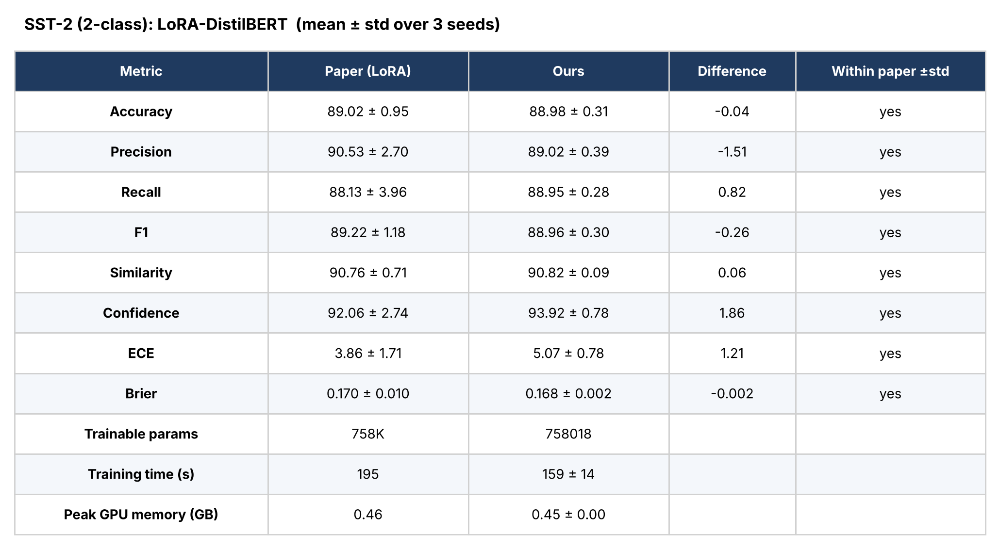

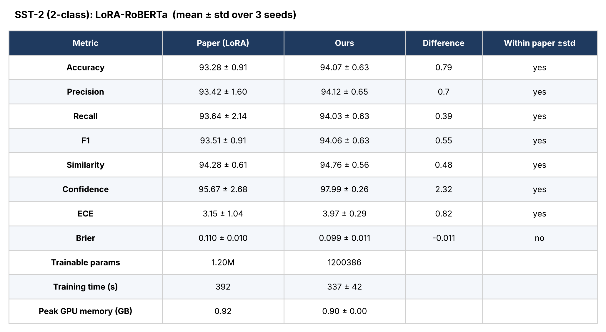

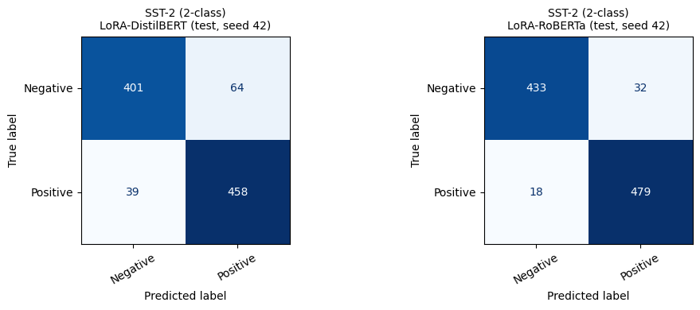

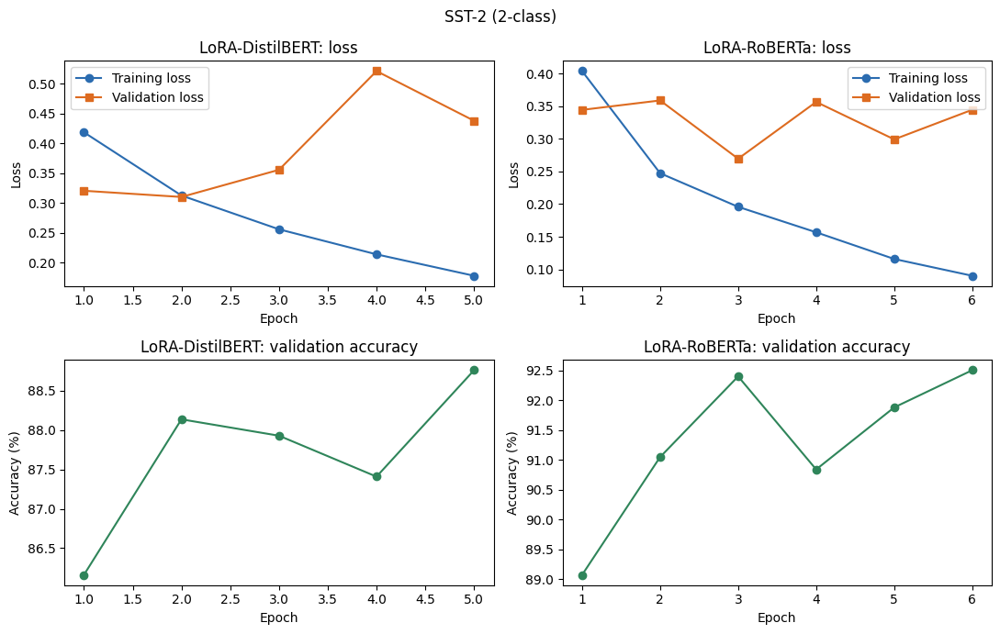

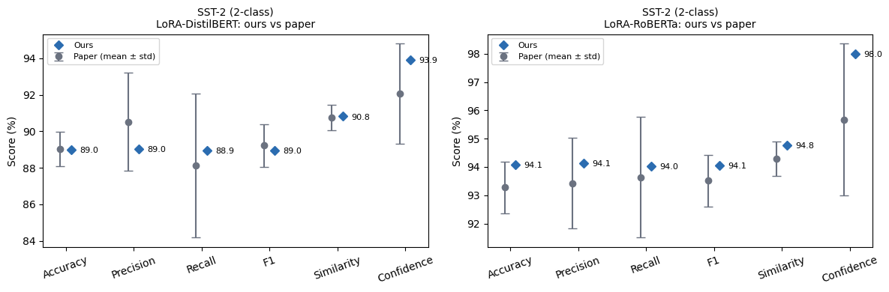

---

### 2. CARER Emotion (6-class)

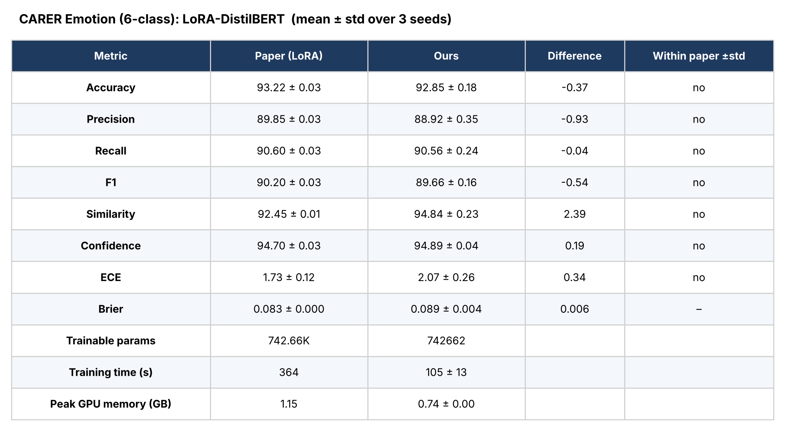

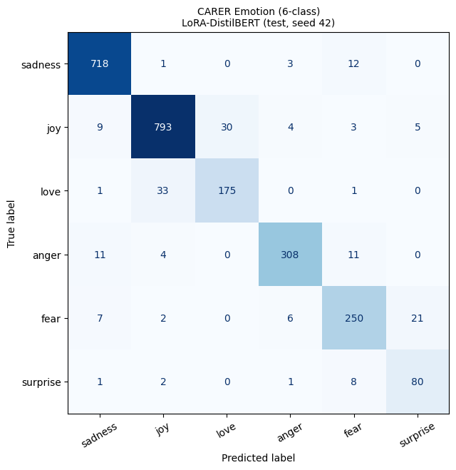

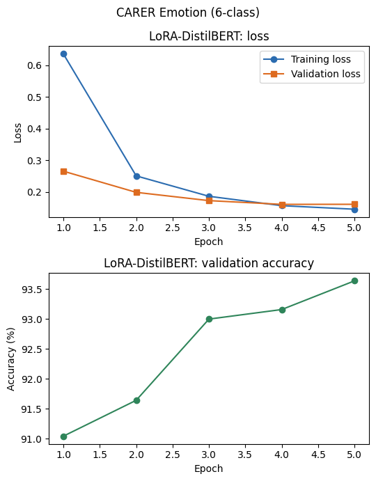

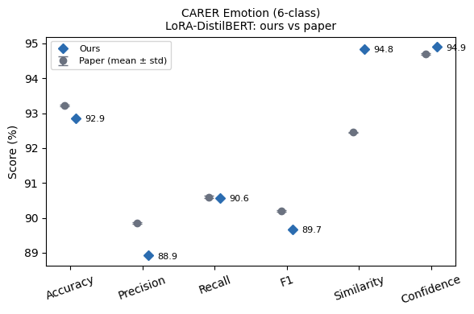

---

### 3. Amazon E-Commerce (5-class)

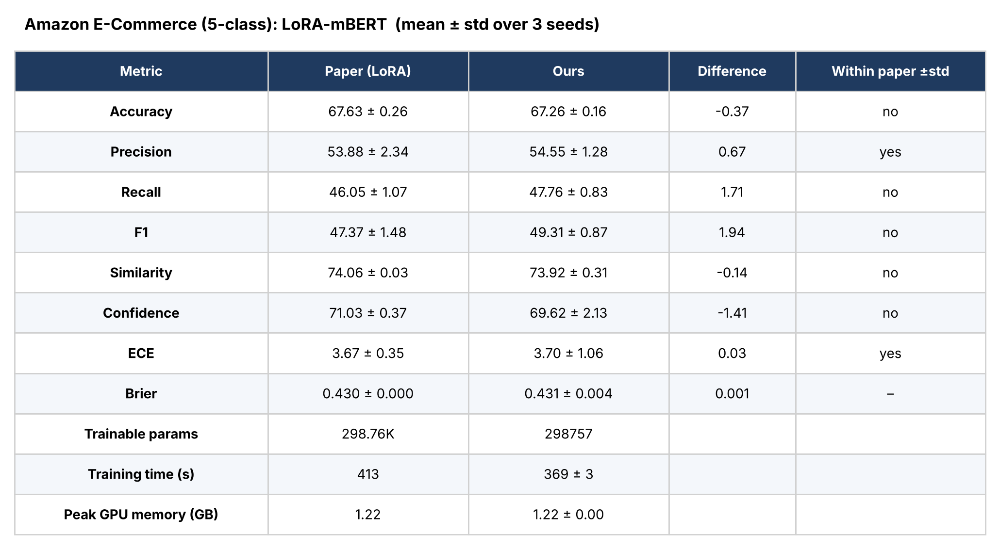

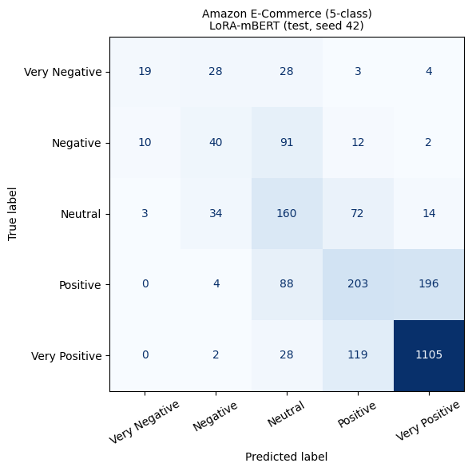

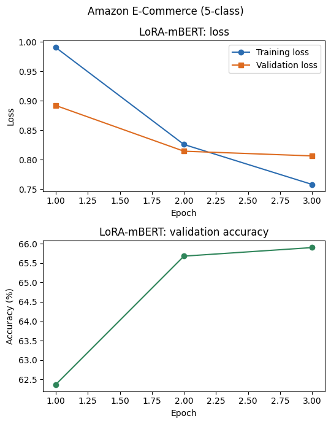

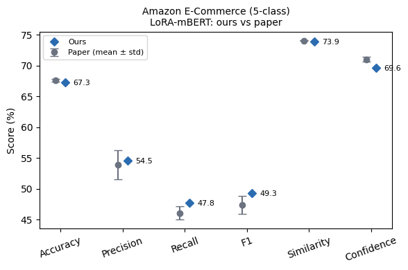

---

### 4. SemEval-2014 ABSA (3-class)

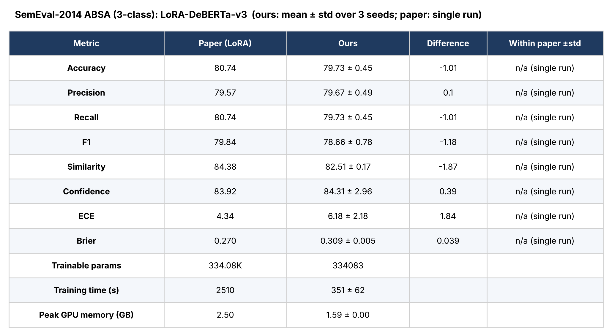

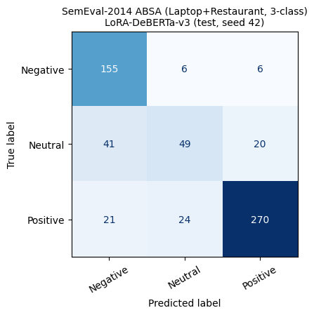

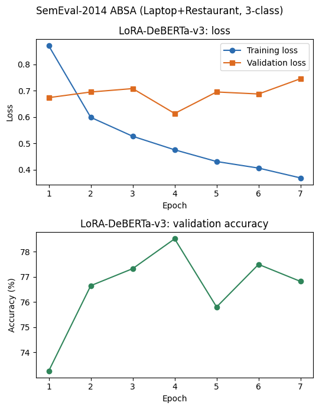

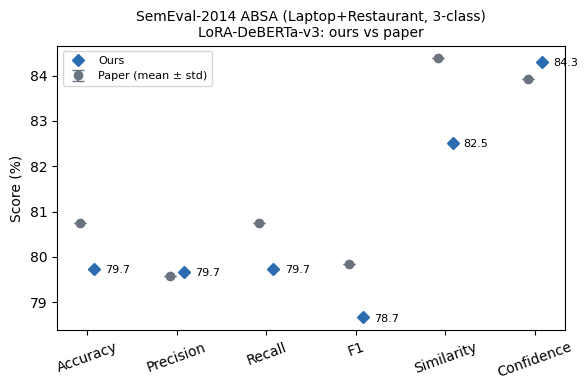

---

### 5. Summary (mean ± std over 3 seeds)

| Dataset | Model | Paper Acc | **Our Acc** | Paper F1 | **Our F1** | Trainable params (paper → ours) |
|---|---|---|---|---|---|---|
| SST-2 | DistilBERT | 89.02 ± 0.95 | **88.98 ± 0.31** | 89.22 ± 1.18 | **88.96 ± 0.30** | 758K → 758,018 |
| SST-2 | RoBERTa-base | 93.28 ± 0.91 | **94.07 ± 0.63** | 93.51 ± 0.91 | **94.06 ± 0.63** | 1.20M → 1,200,386 |
| Emotion | DistilBERT | 93.22 ± 0.03 | **92.85 ± 0.18** | 90.20 ± 0.03 | **89.66 ± 0.16** | 742.66K → 742,662 |
| E-Commerce | mBERT | 67.63 ± 0.26 | **67.26 ± 0.16** | 47.37 ± 1.48 | **49.31 ± 0.87** | 298.76K → 298,757 |
| ABSA | DeBERTa-v3 | 80.74 (single run) | **79.73 ± 0.45** | 79.84 | **78.66 ± 0.78** | 334.08K → 334,083 |

---

## Key Observations

**Why results match the paper:**
- The same backbone, target modules, rank, alpha, dropout, batch size, epochs and weight decay as the paper's Table 3b for every dataset
- Trainable-parameter counts are **identical** to the paper on all five models, which confirms the LoRA setup is the same
- The same 80/10/10 stratified split as the authors, so the test sets are identical
- Accuracy and F1 are within about 1 to 2 points of the paper everywhere
- RoBERTa on SST-2 even exceeds the paper (94.07 vs 93.28), and DistilBERT matches it (88.98 vs 89.02)

**What the results show:**
- LoRA trains only **0.2% to 1.2%** of the parameters and still gives competitive sentiment classification
- Larger backbones help: RoBERTa beats DistilBERT on SST-2 by about 5 points with a similar adapter size
- E-Commerce 5-class has decent accuracy (67%) but low macro-F1 (49%) because the minority rating classes are hard. The paper shows the same pattern
- Our seed-to-seed spread on SST-2 is smaller than the paper's

**Why small differences exist:**
- The Emotion data is the 25,000-row subset from the authors' repository, not the paper's 75,000 rows. Our similarity score there is 2.4 points above the paper's, which we could not explain
- The paper's ABSA numbers are a single run, so they cannot be checked against a standard deviation. Our ABSA calibration (ECE, Brier) is somewhat worse
- The paper does not fully specify how ECE and Brier are computed, so those follow our own implementation
- Training time and GPU memory depend on the hardware and are not directly comparable
- Twitter, IMDb, Yelp, E-Commerce 3-class, full fine-tuning and AdaLoRA are not reproduced

---

## Hyperparameters

| Setting | SST-2 | Emotion | E-Commerce | ABSA |
|---|---|---|---|---|
| Backbone | DistilBERT / RoBERTa-base | DistilBERT | BERT-base-multilingual | DeBERTa-v3-base |
| LoRA target modules | q_lin, v_lin, out_lin / query, value, output.dense | q_lin, v_lin | query, value | query_proj, key_proj, value_proj |
| Rank (r) | 6 | 8 | 8 | 6 |
| Alpha | 12 | 16 | 16 | 12 |
| LoRA dropout | 0.2 | 0.1 | 0.05 | 0.1 |
| Learning rate | 3e-4 | 3e-4 | 3e-4 | 3e-4 |
| Batch size (train / eval) | 8 / 16 | 32 / 64 | 8 / 16 | 8 / 16 |
| Max epochs | 10 | 5 | 3 | 10 |
| Weight decay | 0.05 | 0.01 | 0.01 | 0.2 |
| Warmup ratio | 0.1 | 0.03 | 0.1 | 0.1 |
| Early-stopping patience | 3 | 1 | 3 | 3 |
| Max sequence length | 512 | 512 | 256 | 512 |
| Seeds | 42, 43, 44 | 42, 43, 44 | 42, 43, 44 | 42, 43, 44 |

Common to all runs: AdamW, cosine learning-rate schedule, fp16, dynamic padding, `modules_to_save=["classifier"]`, 80/10/10 stratified split with `random_state=42`.

---

## How to Run

**1. Clone the repository**
```bash
git clone https://github.com/abhimanyu284/SentiMatrix-LoRA-Sentiment-Analysis
cd SentiMatrix-LoRA-Sentiment-Analysis
```

**2. Install dependencies** (needed only for local runs; Kaggle already has most of them)
```bash
pip install -r Requirement.txt
```

**3. Open the notebook on Kaggle**

Create a new Kaggle notebook and import `Code Files/nlp-replication-3.ipynb` (File → Import Notebook). In the notebook settings choose **Accelerator: GPU T4** and turn **Internet: On**.

**4. Run Cell 1**

It installs `sentencepiece` and removes the incompatible `torchao`. Then **restart the session** and run the remaining cells in order.

**5. Automatic downloads**

The notebook downloads the datasets by cloning the authors' repository, so no manual download is needed. It then trains LoRA on all four datasets with three seeds each, saves tables and figures to `/kaggle/working/outputs/`, and zips them to `lora_replication_outputs.zip`.

**6. Keep your results**

Use **Save Version → Save & Run All (Commit)** so Kaggle keeps the output files. Otherwise they are lost when the session ends.

**7. Runtime**

About 75 minutes on a Tesla T4 for all four datasets with 3 seeds. To run only some datasets, edit `DATASETS = ["sst2", "emotion", "ecom5", "absa"]` in Cell 2.

---

## Conclusion

This project successfully reproduces the main LoRA results of the SentiMatrix paper on four datasets. All the key claims were verified: trainable-parameter counts match the paper exactly, only 0.2% to 1.2% of parameters are trained, and accuracy and F1 fall within about 1 to 2 points of the published values on every dataset.

RoBERTa on SST-2 reached **94.07%** accuracy against the paper's **93.28%**, and DistilBERT reached **88.98%** against **89.02%**. The remaining differences come from the smaller Emotion subset, the single-run ABSA numbers in the paper, unspecified calibration-metric details and different hardware.

---

## Reference

Arafat, M. E.; Akmal, M. U.; Abosinnee, A. S.; Orosz, T.
*SentiMatrix: Parameter-Efficient Fine-Tuning of Encoder-Based Transformers for Multidimensional Sentiment Analysis.*
Machine Learning 2026, 115, 229.
https://doi.org/10.1007/s10994-026-07161-4

Authors' code: https://github.com/ELTE-DSED/senti-matrix

---

## Authors

**Abhimanyu Nema, Krishka Kate, Divyanshi Mundhra**

B.Tech AI & DS, NMIMS Indore
